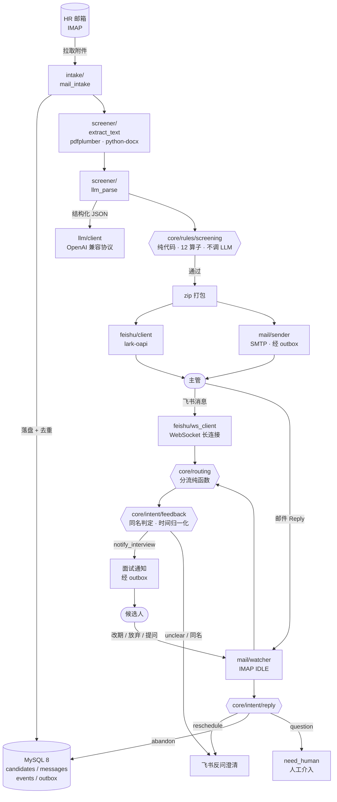
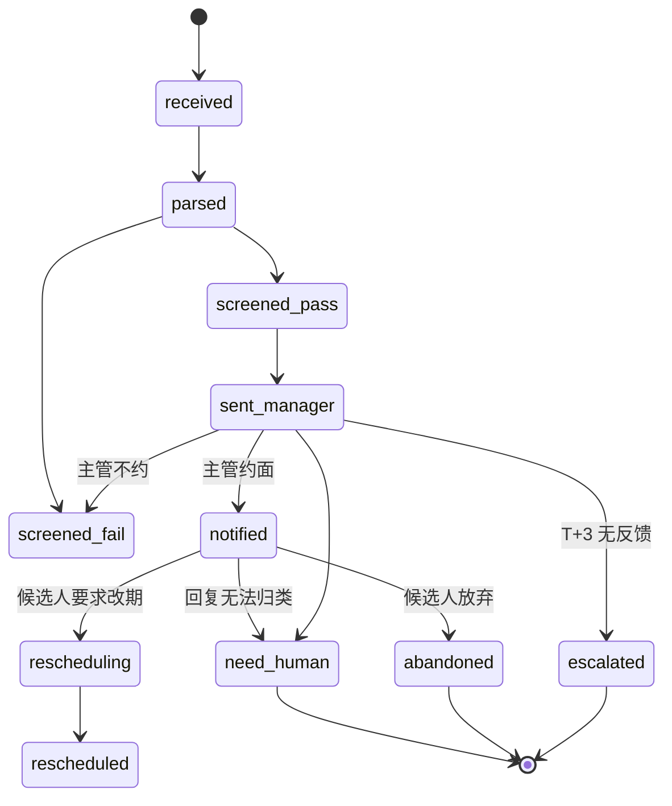

# ai-hr 智能招聘助手

> 定时收取简历 → LLM 结构化抽取 → 确定性规则筛选 → 飞书/邮件双通道送审 → 主管一句话反馈自动推进面试通知。
> 单进程、无前端、配置驱动、全链路留痕的后端服务。

<!-- 技术栈徽章：评审在首屏 3 秒内就能看到关键选型；版本号改这里即可 -->


---

## 技术栈总览

分四组。**"为什么选它" 列是这张表真正的价值**——答辩时被问"为什么不用 X"，答案都在这里。

### 运行时与调度

| 技术 | 版本 | 用在哪 | 为什么选它 / 没选什么 |
|---|---|---|---|
| Python | 3.11 | 全部 | LLM、邮件、飞书 SDK、定时任务的生态都在 Python 侧最完整。没选 Node 是因为 `imap_tools` / `pdfplumber` 在 Python 更成熟 |
| APScheduler | 3.x（`<4`） | `scheduler/runner.py` | 内嵌 `BackgroundScheduler`，与 IMAP watcher 同进程共享一个连接池。没选 systemd timer，因为两个进程要共享 DB，多一层故障点 |
| pydantic-settings | 2.x | `settings.py` | YAML 给 HR 看、pydantic 给代码校验。配置错误在**启动时**炸，而不是跑到一半炸 |

### 外部集成（这是本项目技术密度最高的部分）

| 技术 | 版本 | 用在哪 | 为什么选它 / 没选什么 |
|---|---|---|---|
| **lark-oapi** | 1.x | `feishu/client.py`、`feishu/ws_client.py` | 飞书官方 Python SDK。**关键点：支持 WebSocket 长连接收事件，因此不需要公网 IP、不需要备案域名、不需要 nginx**。没选 webhook 回调，因为它要求公网可达 |
| imap-tools | 1.x | `intake/mail_intake.py`、`mail/watcher.py` | 比标准库 `imaplib` 简洁一个量级，且支持 IDLE（近实时推送）。IDLE 有 RFC 2177 的 29 分钟上限，代码里有重发 + 断线重连循环 |
| smtplib + email | 标准库 | `mail/sender.py` | 发信不需要第三方库。所有发送走 outbox 队列，不直接调 SMTP |
| **OpenAI 兼容协议** | — | `llm/client.py` | 一套代码可切 DeepSeek / Qwen / Kimi / 真 OpenAI，只改 `LLM_BASE_URL` |
| jinja2 | 3.x | `config/templates/*.j2` | 6 个邮件/飞书消息模板，改文案不动代码 |

### 数据

| 技术 | 版本 | 用在哪 | 为什么选它 / 没选什么 |
|---|---|---|---|
| **MySQL** | 8.0 | `store/` | 生产要独立托管的持久化。**明确约束：必须用独立实例，禁止与应用同机自建**——同机自建等于付了 MySQL 的复杂度，没买到它唯一的价值（独立宿主机 + 备份） |
| SQLAlchemy | 2.0 | `store/models.py` | `Mapped[]` 声明式风格，四张表。全部使用通用类型（`JSON` / `String` / `DateTime`），不出现方言类型 |
| Alembic | 1.x | `alembic/` | 有迁移才有 schema 演进的可能。`autogenerate` 之后必须人工 review（它检测不到索引重命名、列注释等） |
| PyMySQL + cryptography | 1.1+ | `store/session.py` | MySQL 8 默认 `caching_sha2_password`，**不装 `cryptography` 会直接连不上** |

### 抽取与文档处理

| 技术 | 版本 | 用在哪 | 为什么选它 / 没选什么 |
|---|---|---|---|
| pdfplumber | 0.11+ | `screener/extract_text.py` | 简历表格多，pdfplumber 对表格和分栏的还原明显好于 PyPDF2 |
| python-docx | 1.x | 同上 | docx 抽取的事实标准 |
| pydantic | 2.x | `core/intent/`、`screener/llm_parse.py` | LLM 输出必须过 schema 校验，校验失败重试 1 次，再失败标 `parse_failed` 留痕不淘汰 |
| loguru | 0.7+ | `core/log.py` | 零配置结构化日志，带敏感字段脱敏过滤器 |

### 工程化

| 技术 | 用在哪 | 说明 |
|---|---|---|
| pytest + 参数化 | `tests/` | `core/` 下纯函数零 mock 可测；集成层用假 IMAP / 假飞书 / 真 MySQL |
| ruff + mypy | 全项目 | 格式化 + 类型检查 |
| uv | 依赖管理 | `uv sync` 一键装环境 |

---

## 架构



**三层依赖方向（单向，不可逆）：**

```
main / settings
   ↓
scheduler · intake · screener · feishu · mail · ops     ← 编排与适配器
   ↓
llm · store                                              ← 外部能力封装
   ↓
core                                                     ← 叶子：无 IO、无 DB、可零 mock 测试
```

> `core/` 的准入规则：只依赖标准库与 pydantic，不碰 DB / 网络 / 文件 / 环境变量。一句话判据：**`pytest tests/test_screening_rules.py` 不设任何环境变量就能跑绿。**

---

## 三条核心数据流

| # | 触发 | 链路 | 结束条件 |
|---|---|---|---|
| 1 | 每天 09:00（APScheduler） | 收简历 → 抽取 → 筛选 → 打包送主管 | 发完即退出，不等反馈 |
| 2 | 主管反馈（飞书长连接 / 邮件 Reply，两路汇入同一解析器） | 解析意图 → 状态推进 → 发面试通知 | 通知发出后写 event |
| 3 | 候选人回复（IMAP IDLE） | 分流 → 改期/放弃/提问 → 改期需主管确认 | 无解析失败的静默丢弃，一律留痕 |

**状态机（12 个状态，英文码值入库）：**



---

## 设计文档

本仓库目前只放 README。设计与口径文档（架构方案 v3.2、筛选规则 DSL、三个 prompt、配置文件）**暂未随仓库提交**，需要时单独索取。

四份文档的分工，供了解项目全貌：

| 文档 | 内容 |
|---|---|
| 架构方案 v3.2 | 状态机（12 态）· 核心流程 · 主管反馈双路径 · 数据库实现层全代码 · 9 步路线图 |
| 文档索引 | 一题一权威：哪个问题该看哪份、还缺什么 |
| 架构说明 | 分层与依赖方向 · `core/` 准入规则 · 三份 ADR · 失败兜底矩阵 |
| 筛选口径（DSL） | 三步筛选 · 12 个运算符 · 归一化公式 · 反例 |

<!-- TODO(当 docs/ 与 config/ 进入仓库后)：把本节表格的"文档"列改成相对链接，
     并恢复顶部"文档地图 → docs/INDEX.md"入口。现在写成文件名，是因为文件还不存在。 -->

> 这份 README 之后会补上仓库内链接。现在写成文件名而不是链接，是因为那些文件还没进仓库——**留死链比不给链接更糟**。

---

## 快速开始

> 代码尚未提交，本节是目标形态的命令清单，用于说明运行方式。

```bash
# 1. 环境
uv sync                                   # 或用 pip install -e .

# 2. 配置
cp .env.example .env                      # 填 LLM_API_KEY / MAIL_PASSWORD / DATABASE_URL ...
$EDITOR config/config.yaml                # 填 positions / 主管飞书 ID / 筛选规则

# 3. 建库（需独立 MySQL 8 实例，不要与应用同机）
alembic upgrade head
python -m scripts.check_db                # 6 项自检：JSON 列 / 复合唯一 / CAS / 时间口径

# 4. 跑
python -m aihr.main run-daily             # 手动跑一轮
python -m aihr.main serve                 # 常驻：调度 + IMAP watcher + 飞书长连接
```

**三个调试用脚本：**

| 脚本 | 用途 |
|---|---|
| `scripts/dry_run.py` | 用历史简历按新规则重算，不改状态不发消息 → 改筛选口径前必须跑 |
| `scripts/whoami_feishu.py` | 让目标用户发条消息，打印 `open_id`（配置主管 ID 用） |
| `scripts/eval_extract.py` | 批量跑简历抽取，输出 `parse_confidence` 与 `missing_fields` |

---

## 目录结构

```
ai-hr/
├── config/
│   ├── config.yaml            # 七段配置：schedule/mailbox/people/positions/templates/llm/retention
│   └── templates/             # 6 个 jinja2 模板（3 封邮件 + 3 张飞书卡片）
├── prompts/                   # 3 个 LLM prompt（简历抽取 / 主管反馈 / 候选人回复）
├── skills/resume_screening.md # 筛选口径 + 规则 DSL（HR 可直接校对）
├── src/aihr/
│   ├── core/                  # ★ 叶子层：无 IO，零 mock 可测
│   │   ├── errors.py  clock.py  log.py  retry.py  text.py  ids.py  routing.py
│   │   ├── rules/screening.py # 12 算子规则引擎（纯函数）
│   │   └── intent/            # feedback.py（同名判定/时间归一化）· reply.py（五类意图）
│   ├── scheduler/             # APScheduler 装配 + 每日任务 + T+1/T+3 提醒
│   ├── intake/                # IMAP 收简历 + (发件人, sha256) 去重
│   ├── screener/              # 文本抽取 → LLM 解析 → 筛选用薄壳
│   ├── feishu/                # lark-oapi 封装 + WebSocket 长连接 + 告警机器人
│   ├── mail/                  # SMTP 发送 / outbox 退避重试 / IMAP IDLE 监听
│   ├── llm/                   # OpenAI 兼容客户端（temperature=0、JSON 输出、重试）
│   ├── store/                 # SQLAlchemy 四表 + CAS 状态机 + 会话管理
│   └── ops/                   # PIPL 留存清理
├── alembic/                   # 数据库迁移
├── tests/                     # 7 个测试文件（4 个纯函数 + 3 个集成）
└── scripts/                   # 4 个运维/调试脚本
```

---

## 三条最硬的设计决定

1. **LLM 只读简历，不判简历。**
   淘汰决定 100% 由 `core/rules/screening.py` 里的确定性规则做出，每条淘汰都有可复现的原因。LLM 不可用时简历只标 `parse_failed`，绝不因此淘汰。

2. **候选人只能从清单里选 id，不让模型自由生成姓名。**
   `core/intent/feedback.py` 把本轮候选清单（id + 姓名 + 一行摘要）注入 prompt，模型只能返回 id。同名场景自然退化为"选不出来 → 反问澄清"，而不是事后做字符串匹配。

3. **每个动作先入 outbox，不直接发。**
   邮件和飞书消息一律写 `outbox` 表后由 worker 投递（1m/5m/30m/2h 退避，4 次失败转 `exception`）。发送失败不再静默丢失。

---

## 已知限制

- 简历是**明文 PII**：`data/resumes/` 必须收紧目录权限，`retention.resume_files_days` 到期自动清理（默认 90 天）。
- 只支持 PDF / DOCX / DOC / HTML / TXT；扫描件 PDF 抽不出文字，会被标 `parse_failed` 转人工。
- 单个飞书文件消息有大小上限，简历包超限时降级为发送飞书云盘链接。
- 不做多租户、不做 Web 界面、不做权限体系——这是一条刻意的边界。

## License

MIT

---

> 当前阶段：设计完成，代码待实现。仓库内容会随 `src/` 落地逐步补齐。

#### 特技

1.  使用 Readme\_XXX.md 来支持不同的语言，例如 Readme\_en.md, Readme\_zh.md
2.  Gitee 官方博客 [blog.gitee.com](https://blog.gitee.com)
3.  你可以 [https://gitee.com/explore](https://gitee.com/explore) 这个地址来了解 Gitee 上的优秀开源项目
4.  [GVP](https://gitee.com/gvp) 全称是 Gitee 最有价值开源项目，是综合评定出的优秀开源项目
5.  Gitee 官方提供的使用手册 [https://gitee.com/help](https://gitee.com/help)
6.  Gitee 封面人物是一档用来展示 Gitee 会员风采的栏目 [https://gitee.com/gitee-stars/](https://gitee.com/gitee-stars/)
