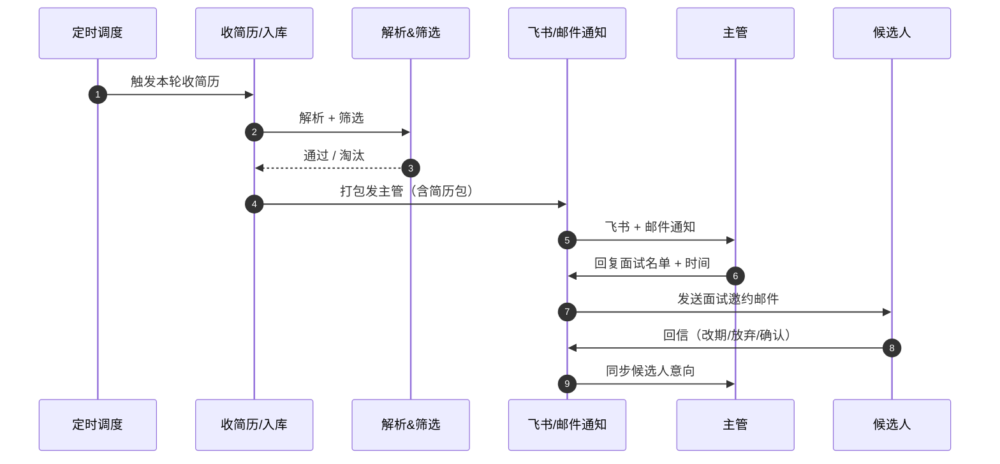
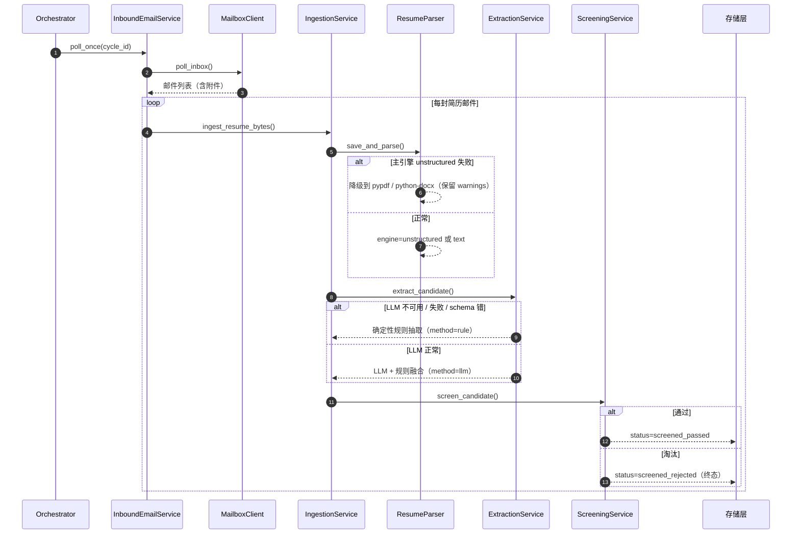
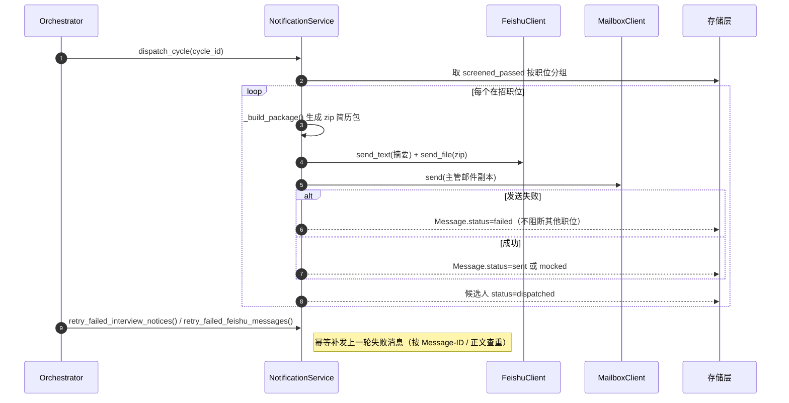
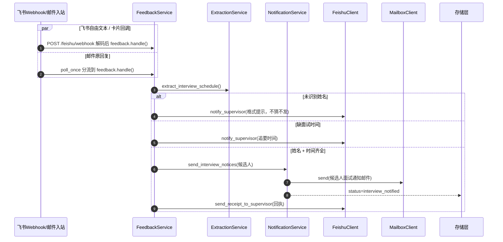
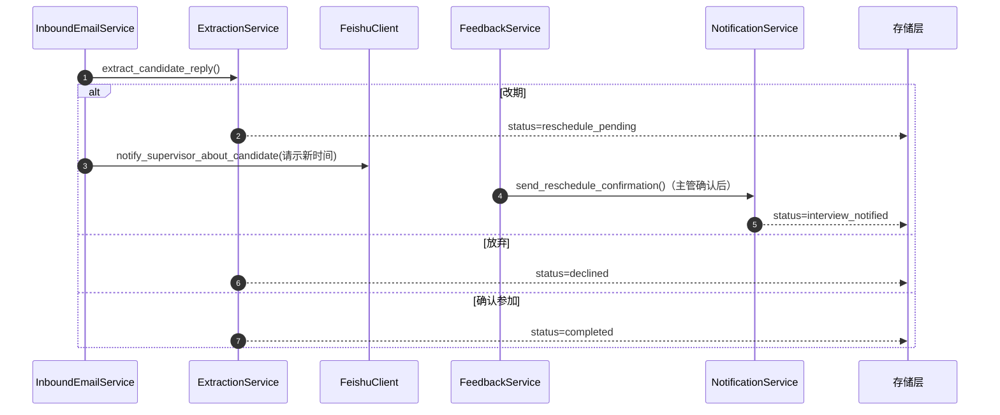
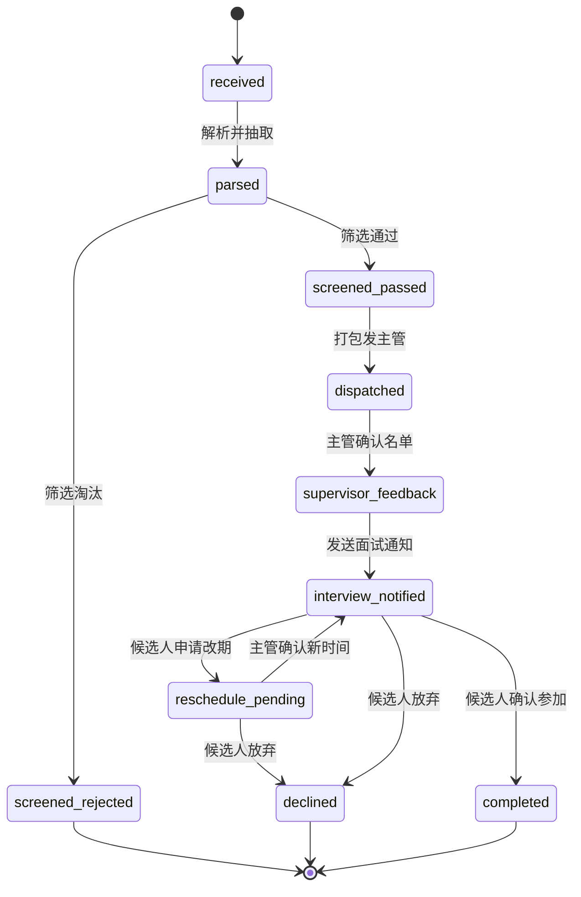

# 架构与设计文档（任务 3：架构与设计文档补齐）

> 本文档仅描述系统现有结构与职责边界，不涉及任何业务代码改动。
> 状态枚举严格对齐 `AGENT.md` 附录 A（10 个取值，不可增删改）。
> 流程图与代码事实逐一对齐（`service/orchestrator.py`、`service/ingestion.py`、
> `service/notification.py`、`service/feedback.py`、`service/inbound_email.py`、
> `service/extraction.py`、`client/feishu.py`、`api/v1/feishu.py`、`client/mailbox.py`）。

---

## 1. 系统完整时序图

覆盖全链路：**定时触发收简历 → LLM 解析 / 规则筛选 → 飞书通知主管（附简历包）→ 主管邮件 / 飞书回复 → 机器人解析意图 → 发送面试邀约**，并体现异步与异常降级路径。

> 为便于阅读，原单张"巨图"已拆分为「1.0 总览 + 1.1~1.4 四个阶段 + 1.5 降级说明」。每张图参与方更少、纵向更短，在飞书文档 / GitHub 渲染时即可放大看清。

### 1.0 端到端总览（谁在什么时候出场）

### 1.1 阶段①：收简历 → 解析 → 筛选（降级内置）

### 1.2 阶段②：打包发主管（飞书 + 邮件副本，附 zip 简历包）

### 1.3 阶段③：主管回复 → 解析意图 → 发面试邀约

### 1.4 阶段④：候选人回信（改期 / 放弃 / 确认）

### 1.5 异常降级总览（全链路 try/except，单步失败不影响可完成部分）

- **异步**：入口为 `APScheduler` 的 `cron` 触发 `Orchestrator.run_daily_cycle()`，整条链路基于 `asyncio` + SQLAlchemy 异步 ORM；`MailboxClient`（IMAP/SMTP）、`FeishuClient`（飞书 API）、`LLMClient` 均为异步 I/O，单封邮件 / 单个职位失败被 `try/except` 隔离，不阻断整轮。
- **解析降级**：`ResumeParser` 主引擎 `unstructured` 失败时，自动降级到 `pypdf` / `python-docx`，`warnings` 留痕，绝不抛异常中断批处理。
- **抽取降级**：`ExtractionService` 在 LLM 不可用、调用失败、或 schema 校验失败时，回落到确定性规则抽取（`method=rule`），业务层通过同一套 Pydantic schema 消费，不感知来源。
- **发送降级**：飞书 / 邮件发送失败只把 `Message.status` 标记为 `failed`，下一轮由 `retry_failed_*` 按幂等键安全补发；单职位派发失败不影响其他部门。
- **归位降级**：简历无法归位到任何在招职位时，`_store_unmatched` 让候选人停留在 `received` 并触发飞书告警，不抛出 HTTP 400，批次继续。
- **编排降级**：`Orchestrator` 中配置同步 / 轮询 / 派发任一失败仅记 `errors` 并继续，`cycle.completed` 仍正常返回。

---

## 2. 候选人状态流转图

严格对齐 `AGENT.md` 附录 A 的 10 个状态枚举（不新增、不改名）：

`received / parsed / screened_passed / screened_rejected / dispatched / supervisor_feedback / interview_notified / reschedule_pending / declined / completed`

**降级兜底**：简历无法归位到任何在招职位时，候选人停留在 `received`（子任务 2 的降级入库 + 飞书告警，不引入新状态），依旧符合附录 A 的 10 状态契约。

**状态机约束（来自 `AGENT.md` §3.2 / 附录 A）**

- 10 个取值是冻结契约：存量数据库以字符串存储，取值永久不可增删改（改类型或改名会让所有历史行"不认识"）。
- 事件动作名（`candidate.received` / `candidate.parsed` / `candidate.dispatched` / `feedback.received` / `interview.notice_sent` 等）是状态机的唯一证据，必须与状态迁移一一对应。
- `screened_rejected` 与 `declined`、`completed` 为终态，仅留痕，闭环不越界（不发感谢信、不做测评通知、不建人才库）。
- 唯一允许的"新增"是事件动作名（`candidate.unmatched_position`，仅追加不破坏既有指纹），状态枚举本身保持 10 个不变。

---

## 3. 模块解耦说明

系统分层：`api/`（HTTP 入口）→ `service/`（业务编排）→ `client/`（外部 I/O 封装）、`repository/`（数据访问）、`model/`（领域模型）、`prompt/`（提示词模板）。

| 模块 | 对应文件 | 职责 | 输入 | 输出 | 依赖关系（谁调用谁） |
|---|---|---|---|---|---|
| 简历解析模块 | `client/resume_parser.py` | 把简历字节 / 文件解析为纯文本 + 引擎标记 + 降级 warnings；不读库、不做业务判断 | 简历字节 / 文件路径 | `ParsedResume`（text / engine / warnings / path） | 被 `IngestionService` 调用；`ExtractionService` 复用其 `prefill()` 做规则预填。自身只依赖文件 I/O 与第三方解析库，**不依赖任何 service / repository** |
| 邮件监听模块 | `client/mailbox.py`（IMAP/SMTP 封装）+ `service/inbound_email.py`（分流编排） | `mailbox` 负责连接邮箱、拉取 / 发送、生成 Message-ID 与 reply 地址；`inbound_email` 负责一轮轮询 + 四类分流（候选人回信 / 主管反馈 / 简历入库 / 忽略） | `mailbox`：IMAP/SMTP 配置、邮件字节；`inbound_email`：邮件对象 + 线程匹配结果 | `mailbox`：`InboundEmail` 列表 / 发送结果；`inbound_email`：`EmailPollResponse`、各候选 `InboundOutcome` | `inbound_email` 调用 `IngestionService`（简历）、`FeedbackService`（主管反馈）、`ExtractionService`（候选人回信意图）、`NotificationService`（通知主管）、`EmailThreadService`（线程匹配）。`mailbox` 被 `inbound_email` 与 `NotificationService` 共同调用 |
| 飞书 Bot 模块 | `client/feishu.py`（SDK 封装）+ `api/v1/feishu.py`（Webhook 入口） | `feishu` 负责事件解码 / 验签、发送文本与文件；`api/v1/feishu.py` 负责接收回调、挑战应答、把事件归一化为 `InboundMessage` 后交给 feedback | `feishu`：open_id、文本 / 文件、原始 webhook body；`api/v1/feishu.py`：HTTP 请求 | `feishu`：发送结果（message_id / ok / error）；`api/v1/feishu.py`：`FeishuWebhookResponse` | `api/v1/feishu.py` 调用 `FeedbackService.handle()`（与邮件主管反馈同一条代码路径）；`feishu` 被 `NotificationService`、`FeedbackService`、`InboundEmailService` 调用。**api 层只做解码与路由，不含业务逻辑** |
| LLM 抽取模块 | `service/extraction.py` + `prompt/`（提示词模板） | 同一套管道处理三类抽取：简历结构化、主管面试安排、候选人回信意图；LLM 优先、规则兜底，统一输出 Pydantic schema 并留 `method` 字段 | 文本 + 候选名单 / 职位 / 当前面试时间等上下文 | `ExtractedCandidate` / `InterviewScheduleSchema` / `CandidateReplySchema` | 被 `IngestionService`（简历）、`FeedbackService`（面试安排）、`InboundEmailService`（候选人回信）调用。依赖 `LLMClient`（可空，空则纯规则）与 `ResumeParser.prefill()`、`prompt/*` 模板。**不写库、不发消息** |
| 存储模块 | `repository/`（数据访问）+ `model/`（领域模型） | `model` 定义 ORM 聚合根（`Candidate`、`Position`、`Message`、`Event` 等）与状态 / 通道常量；`repository` 提供按条件查询、写入、幂等查重等数据访问能力 | SQLAlchemy `AsyncSession` + 领域对象 | 持久化结果与查询结果 | 被所有 `service` 调用（`IngestionService`、`NotificationService`、`FeedbackService`、`InboundEmailService`、`Orchestrator` 等）。`repository` 依赖 `model`；**存储层不反向依赖任何 service / client**，保持最底层 |

**解耦要点**

- **依赖单向**：`api → service →（client / repository / model）`，`prompt` 仅被 `extraction` 引用；除 `notification` 内部为避免循环依赖把 `PositionRepository` 延后注入（`self.positions=None`）外，不存在 service 间的反向依赖。
- **职责隔离**：`client` 只封装外部 I/O（邮箱 / 飞书 / LLM / 解析库），不含业务规则；`service` 编排业务流程与状态迁移；`repository` / `model` 是纯数据层。
- **统一契约**：`ExtractionService` 用同一套 schema 收敛"LLM 还是规则"，`NotificationService` 用同一套 `Message` 表收敛"邮件还是飞书"，上游业务层不感知通道与来源差异。
- **可离线可测试**：所有外部依赖（`LLMClient`、真实邮箱、真实飞书）均可在测试中以 mock 替换，无需网络即可跑通全链路（当前测试套件 147 passed，0 failed）。
