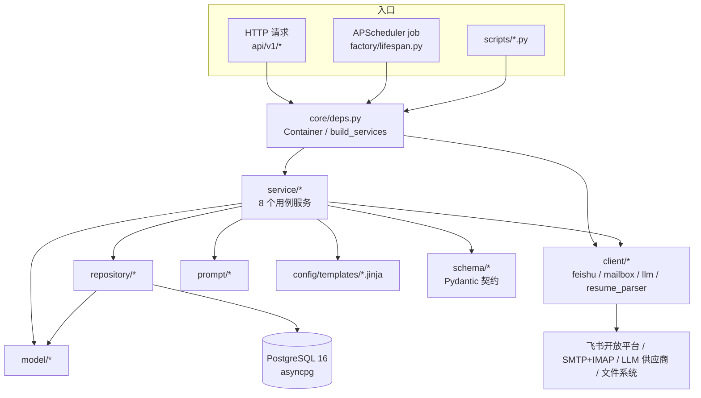
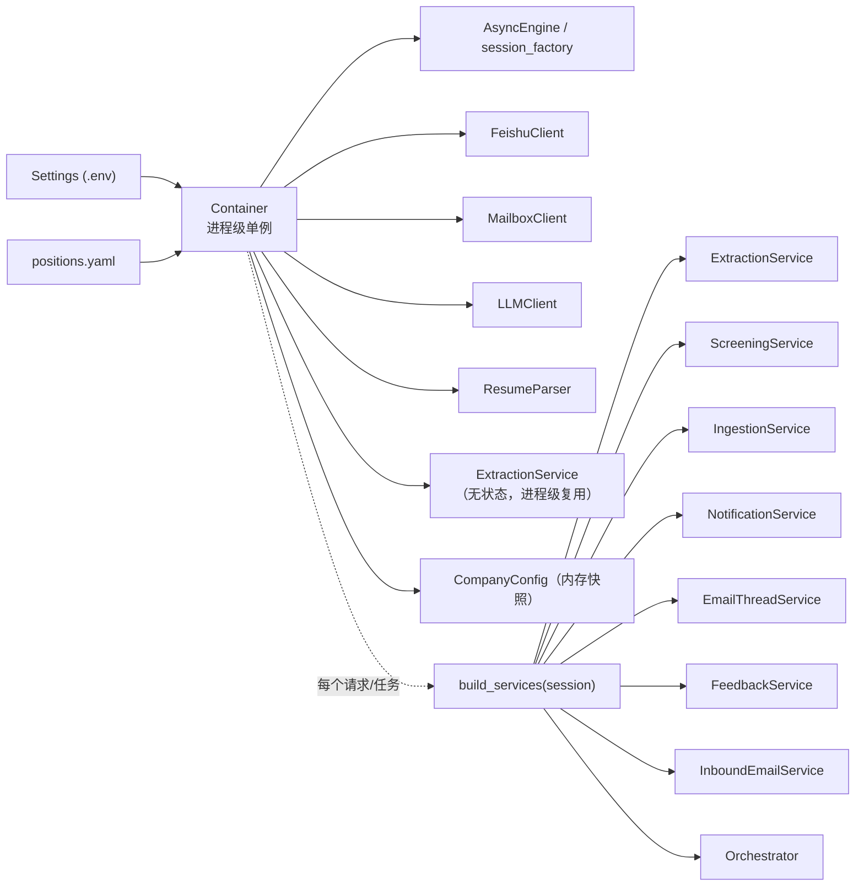

# 02 · 架构与依赖方向

基于 commit `bf2cc81`。所有结论附 `文件:行号`；标 `推断` 的是源码未显式声明、由结构推出的意图。

---

## 1. 分层与真实依赖方向

文档宣称的依赖方向（`AGENT.md:126-136`、`README.md:126`、`docs/design/architecture.md:218`）：
`api → service → repository → model`，且"所有出网动作只在 `client/`"。

**源码实际成立的依赖**（直接证实）：



### 1.1 三条与文档不一致的依赖（如实记录）

| 观察 | 证据 | 影响 |
|---|---|---|
| **api 层直接调 repository**：`/candidates`、`/events`、`/messages`、`/positions` 四个查询接口绕过 service | `api/v1/recruitment.py:76-78`、`:98`、`:122`、`:147`、`:173` | 与"`api/` 只解析参数+注入依赖"的纪律冲突；只读查询，风险低，但读接口的过滤逻辑不在 service 层，未来换数据源要改 API |
| **service 间横向调用**：`IngestionService` 内部自行 `new ScreeningService`；`InboundEmailService` 调 `FeedbackService`/`IngestionService`/`NotificationService`；`FeedbackService` 调 `AgentService`/`NotificationService`/`ExtractionService` | `service/ingestion.py:308-311`、`core/deps.py:139-178`、`service/feedback.py:102-109` | 编排是"服务间直接组合"而非事件总线，改动一个用例要读 3 个 service |
| **`core/` 并非纯底座**：`core/deps.py` 反向 import 全部 service 与 client，是事实上的 composition root | `core/deps.py:18-35` | `core/` + `factory/` 共同承担 DI；把 `core/deps.py` 当成"跟业务无关"会误判循环依赖风险 |

`client → DB` 的反向依赖**未发现**：所有 `client/*.py` 只 import `config.settings`、`core.exceptions`、`core.logging`、`core.threading`、`schema.*`，无 SQLAlchemy session（直接证实）。"出网只在 client"这一条成立。

---

## 2. 进程内装配（Container → Services）



- `Container`（`core/deps.py:40-57`）：进程级，持有 settings/engine/session_factory/四个 client/一个 ExtractionService/公司配置；`config_error` 字段用于"YAML 写坏也不拖垮进程"（`core/deps.py:66-70`），由 `/health` 反映为 `degraded`（`factory/app.py:54`）。
- `build_services(session)`（`core/deps.py:121-190`）：请求/任务级，绑定一个 `AsyncSession`，构造 8 个 service，服务之间只通过构造参数协作，**无全局可变状态**（注释 `core/deps.py:6-7` 自述，源码一致）。
- 全局单例通过 `set_container/get_container`（`core/deps.py:90-102`）暴露；`create_app()` 每次调用都会 `set_container`（`factory/app.py:34`），测试里即"每个用例换一套容器"。
- `NotificationService.positions = None`，注释说明"由调用方按需注入（避免循环依赖）"（`service/notification.py:69`）；实际全仓库没有任何地方给它赋值（`grep` 仅此一处），即这个占位**是死字段**。

---

## 3. 定时任务：启动方式与防重

`factory/lifespan.py`：

| 关注点 | 实现 | 证据 |
|---|---|---|
| 启动点 | FastAPI `lifespan` 上下文管理器 | `factory/lifespan.py:85-108` |
| 建表 | 启动时 `await init_models(container.engine)`（= `Base.metadata.create_all`，幂等） | `factory/lifespan.py:90` → `core/db.py:35-44` |
| 调度器 | `AsyncIOScheduler(timezone=settings.timezone)`，**内存 job store** | `factory/lifespan.py:50` |
| 每日 job | id `hr_daily_cycle`，`CronTrigger.from_crontab(cron)`；cron 取 `SCHEDULE_CRON` → `positions.yaml:schedule.cron` → 兜底 `0 9 * * *` | `factory/lifespan.py:52-63` |
| 入站轮询 job | id `hr_inbound_poll`，`IntervalTrigger(seconds=INBOUND_POLL_SECONDS)`；`<=0` 不注册 | `factory/lifespan.py:65-76` |
| 防重（单进程内） | `coalesce=True`、`max_instances=1`、每日 job `misfire_grace_time=3600`、轮询 job `60` | `factory/lifespan.py:60-62,73-75` |
| 防重（跨进程） | **无**。无共享 job store、无分布式锁、无 DB 级抢占 | `AGENT.md:204` 自述"多副本部署需换共享 job store + 分布式锁"；代码中确无 |
| 开关 | `SCHEDULER_ENABLED=false` 只起 HTTP 不调度 | `factory/lifespan.py:93` |
| 退出 | `scheduler.shutdown(wait=False)` + `container.aclose()`（关 llm、dispose engine） | `factory/lifespan.py:104-108`、`core/deps.py:55-57` |
| 异常兜底 | 两个 job 各自 `try/except` + `session.rollback()` + `logger.exception`，不让调度器丢任务 | `factory/lifespan.py:28-45` |

> 本机当前 `.env` 的 `INBOUND_POLL_SECONDS=0`（运行证实），所以运行时只有每日 cron 一个 job；入站处理靠"每日轮询 + `/email/poll` + 模拟入站接口"。

---

## 4. 外部系统边界

| 边界 | 封装 | 真实调用点 | 三态开关 |
|---|---|---|---|
| 飞书开放平台 | `client/feishu.py`（lark_oapi） | `notification._dispatch_position`（群文本+群文件）、`notify_supervisor`、`request_interview_approval`、`ingestion._alert_unmatched` | `FEISHU_MODE=mock/live`；`FEISHU_PUSH_TARGET=group/user`（`config/settings.py:213-224`） |
| SMTP | `client/mailbox.py:193-211`（aiosmtplib） | `send_interview_notice`、`send_reschedule_confirmation`、`_send_supervisor_email`、`/email/test` | `MAIL_MODE=mock/live/off` |
| IMAP | `client/mailbox.py:263-306`（imaplib + UID 水位 `var/imap_state.json`） | `poll_inbox()`：每日闭环与入站轮询都经它 | 同上 |
| LLM（OpenAI 兼容） | `client/llm.py`（litellm 或 httpx 直连） | 简历抽取、面试安排抽取、候选人回信意图、语义分/深度解析、Agent 路由与作答 | `LLM_MODE=auto/live/off` + `LLM_PROVIDERS` 链 |
| 文件系统 | `config/settings.py:120-139` 派生路径 | `var/resumes`（简历原件）、`var/packages/<cycle_id>`（zip）、`var/outbox/mail`（mock 发件）、`var/mock_inbox`（mock 收件） | — |
| 数据库 | `core/db.py` | 6 张业务表 + `alembic_version` | `DATABASE_URL` |

**入站事件归一**：飞书事件与邮件都先转成 `schema.message.InboundMessage`（`schema/message.py:25-51`），业务层不感知渠道差异——这条在源码中成立（`api/v1/feishu.py:37` 与 `service/inbound_email.py:119-133` 都构造同一模型后交 `feedback.handle()`）。

---

## 5. 请求链路（真实执行顺序）

### 5.1 HTTP 读接口
```
Client → RequestIdMiddleware（core/logging.request_id_ctx）
       → AccessLogMiddleware（方法/路径/状态/耗时）
       → api/v1/recruitment.py:list_candidates（Depends(get_services)）
       → core/deps.py:222-229（开 session → build_services）
       → repository/candidate.py:search → model/candidate.py
       → schema/candidate.py:CandidateRead.from_model（含时区格式化）
       → 异常：core/exceptions.AppError → middlewares/exception.py:31-63 统一信封
```
证据：`factory/middleware.py:16-19`、`middlewares/exception.py:20-28`、`core/logging.py:18-32`。

### 5.2 飞书入站
```
POST /api/v1/feishu/webhook
→ FeishuClient.decode_webhook（encrypt 解密 + verification token 校验）  client/feishu.py:402-416
→ 挑战应答（type=url_verification 或含 challenge）                      api/v1/feishu.py:33-34
→ normalize_event（im.message.receive_v1 / card.action.trigger）          client/feishu.py:435-446
→ FeedbackService.handle(inbound)                                        service/feedback.py:112
→ 幂等/审批/路由/排期分支（见 03_BUSINESS_FLOWS.md）
```

### 5.3 定时闭环
```
AsyncIOScheduler → run_daily_job(container)                              factory/lifespan.py:28-35
→ 新 session → build_services → Orchestrator.run_daily_cycle()           service/orchestrator.py:73
→ sync_config() → inbound.poll_once() → notification.dispatch_cycle()
→ retry_failed_*() → RunCycleResponse + cycle.completed 事件 + commit
```

---

## 6. 源码无法证实的设计意图（标 `推断`）

1. `service/notification.py:69` 的 `self.positions = None` 注释说"由调用方按需注入"，但无任何注入点——`推断` 是早期版本遗留的占位，现已由 `session.get(Position, ...)` 取代。
2. `core/timeparse.py` 单独成层（`docs/DECISIONS.md:34` D-008 有记载），`推断` 目的是把中文时间解析从 service 中剥离以便单测（`tests/test_timeparse.py` 28 个用例支持这一判断）。
3. `schema/agent.py` 的 `AgentIntent` 与 `normalize_intent`（`service/agent.py:177-181`）用于"模型输出不稳定时归一"，`推断` 是因为实际部署的 qwen 系列返回过非枚举字符串（`docs/ops/llm-setup.md` 有相关记录，未逐行核对）。
4. 数据库从 SQLite 迁到 PostgreSQL 后，`core/db.py:22-24` 仍保留 SQLite 分支与 `init_models`，`推断` 是为本地一次性脚本与历史迁移脚本兜底，而非主路径。

---

## 7. 架构层面最需要关注的三个事实

1. **两套建表路径并存**：运行时 `create_all`（`factory/lifespan.py:90`）+ Alembic 迁移（`migrations/versions/0001_initial.py`）。模型加列后若不生成迁移，生产库靠 `create_all` 不会补列（`create_all` 只建缺失的表，不改已有表结构），会出现"代码有列、库没列"的漂移。
2. **状态推进与发送结果解耦**：`dispatch` 与 `send_interview_notice` 里候选人状态在发送**之后无条件推进**（`service/notification.py:175-192` 不看 `feishu_text.ok`；`:422-426` 不看 `result.ok` 也置 `interview_notified`），失败仅体现在 `messages.status=failed` 与事件 detail。
3. **无跨进程互斥**：`max_instances=1` 只约束单进程；一旦 `uvicorn --workers N` 或双副本，每日闭环会并发跑两次（`sync_config` 的 upsert 是幂等的，但 `dispatch_cycle` 会重复发简历包，幂等键只在面试通知上生效）。
