# 03 · 业务流程与调用链

每条链标注**真实文件:行号 + 函数**。凡源码中不存在的能力，明确写"未发现实现"，不补画。

---

## 1. 定时任务触发

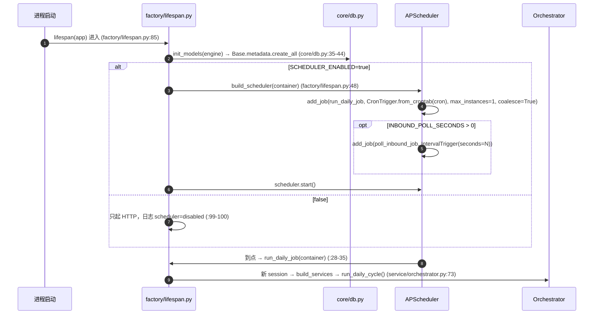

关键事实：
- cron 取值优先级 `SCHEDULE_CRON` → `positions.yaml:schedule.cron` → `"0 9 * * *"`（`factory/lifespan.py:52`）。
- job 内部异常被 `try/except` + `rollback` + `logger.exception` 吞掉，调度器不会因此丢任务（`factory/lifespan.py:33-35`）。
- **未发现**：跨进程去重、任务持久化、补跑游标。`misfire_grace_time=3600` 只保证错过一小时内仍执行。

---

## 2. 邮箱收取简历（IMAP 增量 / mock 目录）

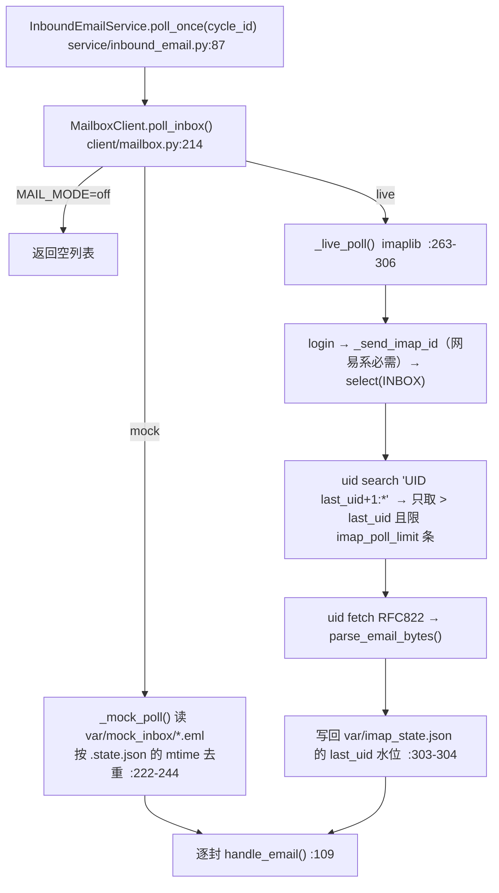

事实：
- UID 水位是"只进不退"：`last_uid = max(last_uid, uid)`（`client/mailbox.py:297`），因此**同一封邮件不会被处理两次**，但也意味着"处理中崩溃"的邮件不会自动重投（无重试队列）。
- `imap_poll_limit=30` 是**单轮上限**（`client/mailbox.py:290`），如果积压超过 30 封，靠下一轮继续推进水位。
- 网易系邮箱在 `SELECT` 前强制 `ID` 命令，否则报 `Unsafe Login`（`client/mailbox.py:246-261`）——这是实测问题的修复，非通用协议要求。

---

## 3. 附件保存与文档解析（含子进程隔离）

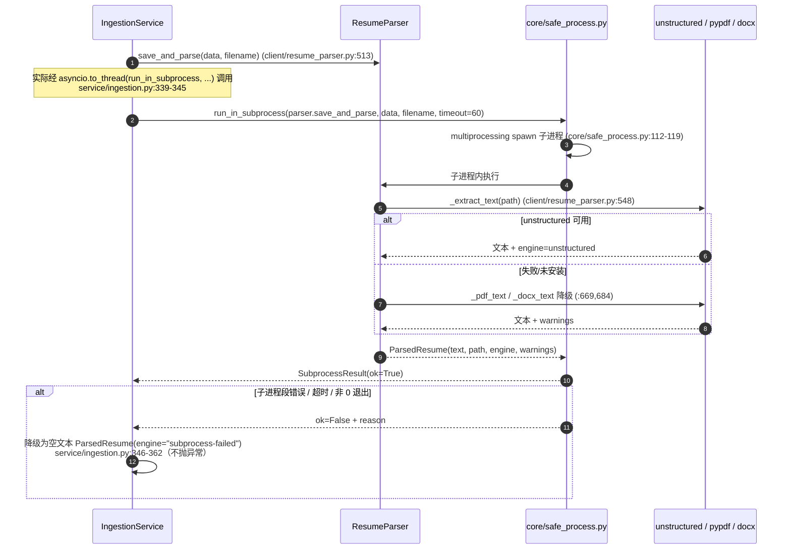

事实：
- 简历原件落盘路径由 `ResumeParser.save_and_parse` 写入 `settings.resumes_dir`（`var/resumes/`），文件名带时间戳+短哈希（见 `var/e2e/var/resumes/20261113150539-ed52d5-陈昊然-简历.txt` 这类实际产物）。
- 解析上限 60 秒（`service/ingestion.py:45` `_PARSE_TIMEOUT_SECONDS`）。
- `core/safe_process.py` 的核心设计：**先消费结果队列再 join**，避免 feeder 线程与主进程互等被误判超时（该模块 docstring 记录了一次 8.7MB PDF 被误杀的实测）。
- `ParsedResume.text` 入库时截断 50,000 字符（`service/ingestion.py:264`）。

---

## 4. LLM 结构化抽取（规则先跑，模型补全）

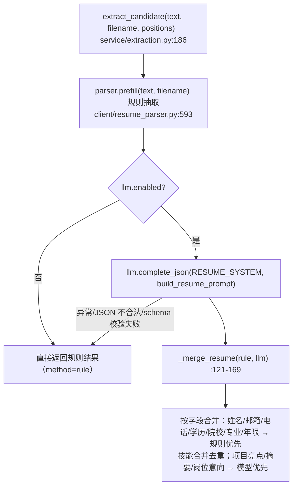

事实与理由（docstring `service/extraction.py:121-132` 直接写明）：
- 基础字段规则优先，因为"正则与词典校验比模型可靠"；年限用"工作时间区间并集"，比模型读文字准。
- 简历里没有的字段（如 BOSS PDF 的字符分隔排版）由 `_guess_name` 从**主题/附件名**兜底（`service/ingestion.py:562-579`），这是 2026-11-12 的实测修复。
- 三个 LLM 节点共用同一降级策略：**只在调用失败时降级，不因结果不理想降级**（`AGENT.md:145-146` 明写；`client/llm.py:341-355` 只在异常时换供应商）。

---

## 5. 去重与职位归类

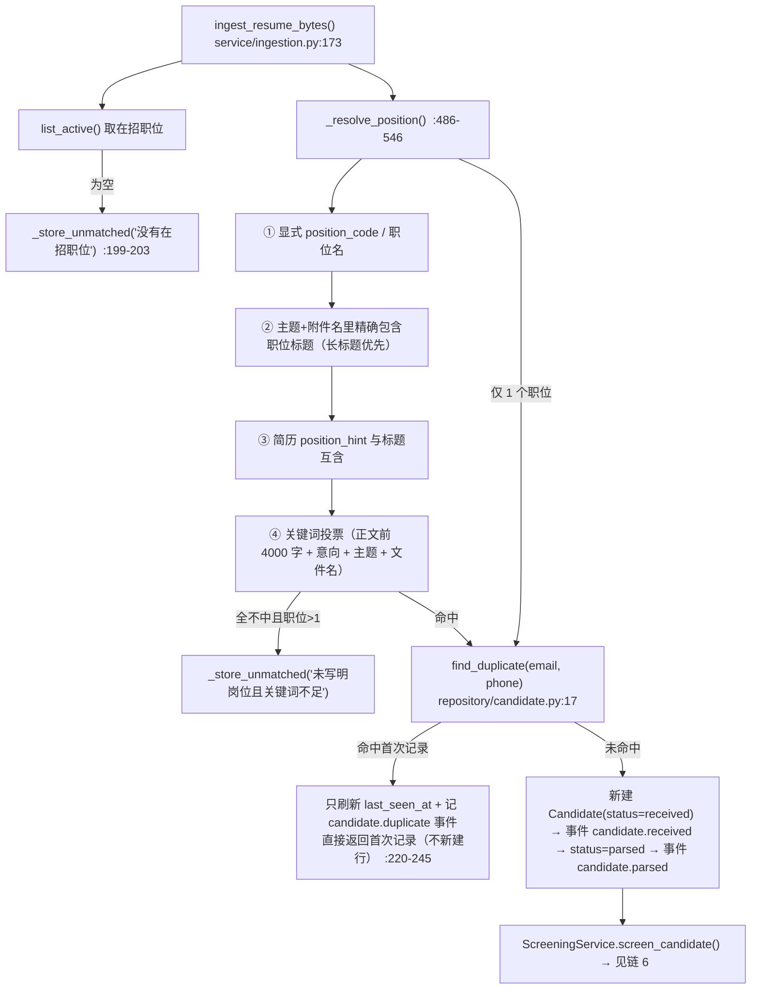

事实：
- 归位顺序的动机写在 docstring：BOSS 的主题/附件名里明写岗位，"岗位名比关键词强得多"（`service/ingestion.py:496-501`），修的是"7 份 Python 简历被算法工程师抢走"的实测故障。
- **未归位不是失败**：`_store_unmatched` 新建 `Candidate(position_id=None, status=received)`，记 `candidate.unmatched_position` 事件，并向"第一个有效主管 open_id"发飞书告警（`service/ingestion.py:364-452`；接收人由 `core/deps.py:196-206` 派生）。
- 去重口径：`email` **或** `phone` 任一命中即重复（`repository/candidate.py:17-32`），且只在 `is_duplicate=false` 的记录里找（该列从不被置 true，等价于全表）。
- 平台共享发件人（`cv@notice.zhipin.com` 等）不会写进 `candidates.email`（`service/ingestion.py:454-479` + `service/email_threading.py:51-59`）。

---

## 6. 规则筛选 + AI 辅助分析

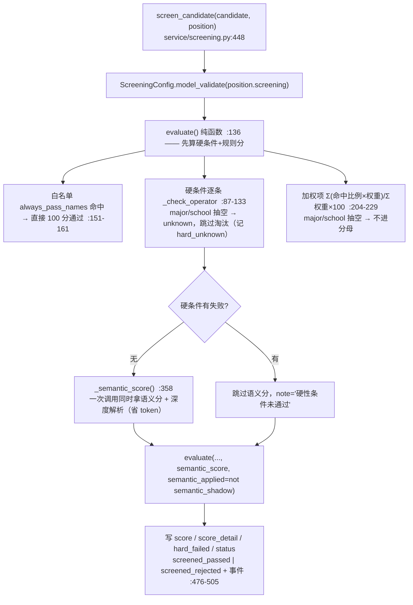

事实：
- 打分公式与 `prompt/screening.md` 一致：`Σ(命中比例 × 权重) / Σ权重 × 100`。
- **影子模式**（`SEMANTIC_SHADOW=true`，本机生效）：语义分照常调用与落库，但 `semantic_applied=False`，通过与否仍按规则分（`config/settings.py:75-80`、`service/screening.py:463-465`）。
- 语义分**不能推翻硬条件**：硬条件失败时根本不调用模型（`service/screening.py:459-461`）。
- 深度解析只做展示：`_normalize_deep` 把维度分夹到 0–100、列表裁到 3 条，全 0 视为"照抄示例"而降级（`service/screening.py:293-327,436-444`）。
- 淘汰是终态：`screened_rejected` 之后不会进入分发/通知（`AGENT.md:190`；代码侧由 `dispatch_cycle` 只取 `screened_passed` 保证）。

---

## 7. 简历包生成与主管推送（飞书 + 邮件副本）

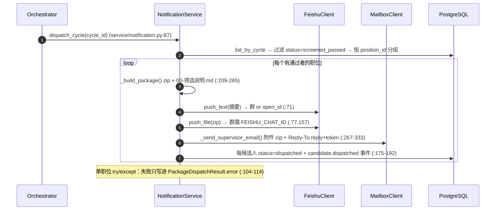

事实与风险：
- 简历包命名为 `{部门}-{职位}-简历{N}份-{yyyymmddHHMM}.zip`，落在 `var/packages/<cycle_id>/`（`service/notification.py:217-221`）。
- 主管邮件是本链的**关键一环**：没有这封邮件，主管就没法"在原邮件上回复"（`AGENT.md:74`）；未配 `supervisor_email` 时直接跳过并返回 `ok=False, detail="主管未配置邮箱"`（`service/notification.py:276-277`）。
- 群推送细节：有 `FEISHU_CHAT_ID` 用**应用身份**发（`im/v1/messages`），只有 webhook 时才用自定义机器人；文件必须走应用身份上传（`client/feishu.py:85-243`），失败会在群里补一句人话提示（`client/feishu.py:245-258`）。
- ⚠️ **状态推进不看发送结果**：`candidate.status = DISPATCHED` 在 `_dispatch_position` 里无条件执行（`:177`），`feishu_text.ok`/`file_result.ok` 只影响返回值与 `messages.status`。

---

## 8. 主管通过飞书反馈

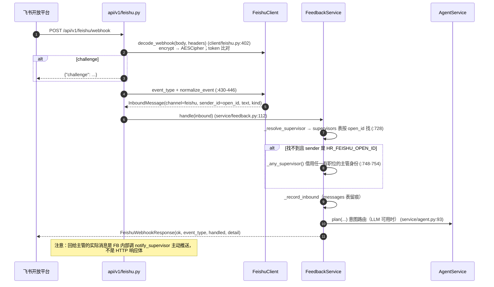

事实：
- 只支持两种事件：`im.message.receive_v1`、`card.action.trigger`（`client/feishu.py:442-446`），其它事件返回 `handled=false`。
- 验签现状：**只比对 verification token**，未见 `X-Lark-Signature` 校验（`client/feishu.py:412-415`）。
- 加密体依赖 `lark_oapi.core.utils.AESCipher`，取不到即抛 `ConfigurationError`（`client/feishu.py:418-428`），`AGENT.md:202` 明确"不自行实现 AES"。
- 回消息走主动推送而非回调响应（`service/feedback.py:257,283,352`），因此**飞书侧需要保证应用有发消息权限**，与"事件回调"是两套权限。

---

## 9. 主管通过邮件线程反馈

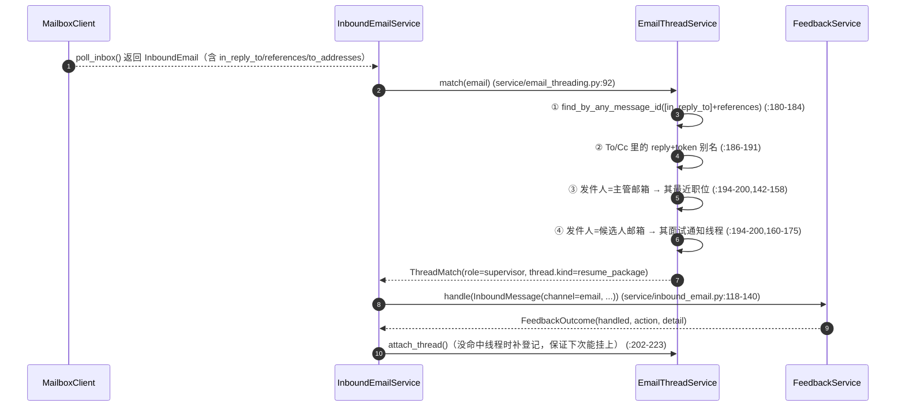

事实：
- **带简历附件的邮件一律优先入库**，即使线程匹配命中了主管/候选人（`service/inbound_email.py:113-118`、`service/email_threading.py:62-73,97,130-135`）。修复的是"平台共用 noreply 发件人把 9/20 封简历吞成回信"的实测事故。
- 平台通知地址（`noreply`/`notice`/`cv@` 等）不作为身份依据（`service/email_threading.py:45-59,139-140`）。
- 线程表里同时存 `message_ids`（JSON，审计）与 `message_id_index`（空格拼接字符串，LIKE 匹配走索引）（`model/email_thread.py:36-40`）。
- 回复地址 `reply+<token>@<HR邮箱域名>`（`client/mailbox.py:91-93`），token 兜底匹配在 `service/email_threading.py:226-231`。

---

## 10. 反馈解析、校验与状态更新

`FeedbackService.handle()` 的分支顺序（`service/feedback.py:112-208`，顺序本身是设计）：

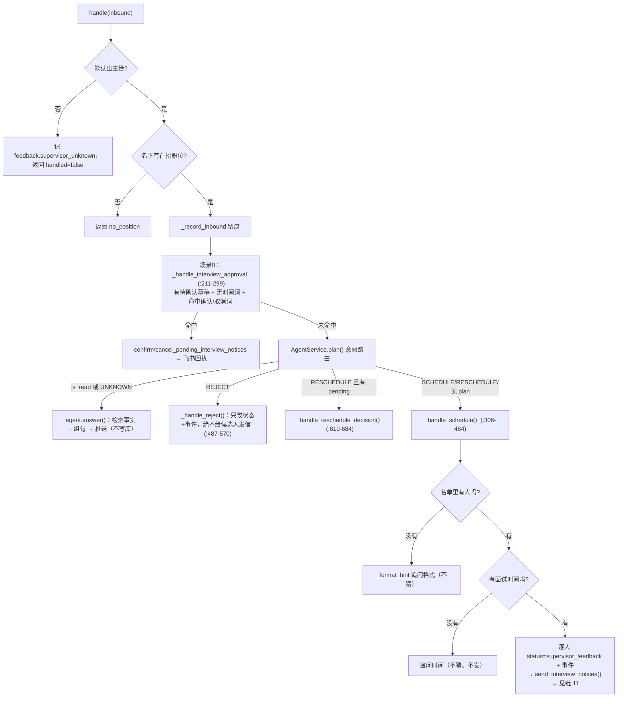

关键校验（"机器人的五条判定规则"在代码里的落点）：

| 规则（`AGENT.md:150-159`） | 代码落点 |
|---|---|
| 时间只来自主管 | `_handle_schedule` 只接受 `schedule.interview_time`，候选人提议的时间只用于"请示主管"（`service/feedback.py:639`） |
| 缺信息只追问 | 缺名 `:349-366`；缺时间 `:368-384` |
| 姓名必须接地 | `names = [n for n in schedule.candidate_names if n in set(roster_names)]`（`:349`）；Agent 写操作再过滤一次（`service/agent.py:161-163`） |
| 改期必须主管点头 | 候选人回信只置 `reschedule_pending`（`service/inbound_email.py:223-225`），补发确认仅在 `_handle_reschedule_decision` 里 |
| 重复投递不覆盖 | `service/ingestion.py:220-245` |

---

## 11. 面试通知邮件发送（含人工确认闸门）

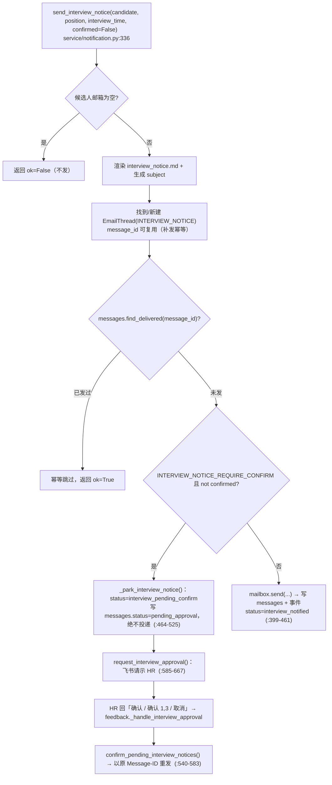

事实：
- 闸门默认开启（`config/settings.py:69` 默认 `True`；本机 `.env` 生效为 true）。
- 确认后沿用**原 Message-ID**（`service/notification.py:575`），因此重复确认不会重复发信。
- 取消会把候选人退回 `dispatched` 并清空 `interview_time`（`:686-689`）。
- 本机 `INBOUND_POLL_SECONDS=0`，但人工确认走飞书 webhook，不依赖轮询。CLI 入口：`scripts/interview_notices.py`；`.bat`：`确认发送面试通知.bat`、`查看待确认面试通知.bat`。

---

## 12. 候选人确认 / 改期 / 放弃

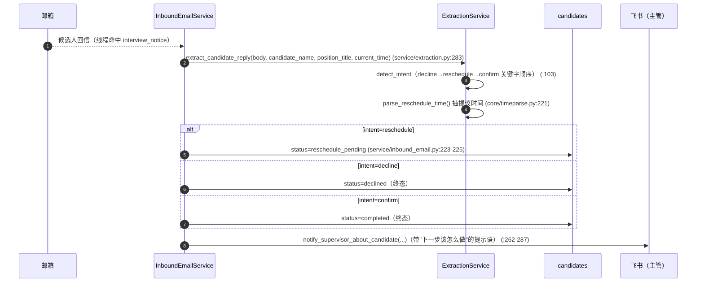

事实：
- 意图判定是**规则优先**：`decline` 关键字先于 `reschedule` 先于 `confirm`（`service/extraction.py:103-111`）；LLM 只在可用时改写为更准的 intent，且"模型说 other 但规则是非 other"时保留规则（`service/extraction.py:331-332`）。
- 改期确认由主管触发：`_handle_reschedule_decision` 支持"直接给新时间"或"同意"（沿用候选人提议的时间，从 `candidate.reply.reschedule` 事件里读回，`service/feedback.py:687-697`）。
- 改期确认邮件走 `send_reschedule_confirmation`，复用同一线程的 `In-Reply-To/References`（`service/notification.py:849-864`）。

---

## 13. 异常、重试、幂等与人工介入

| 机制 | 实现 | 证据 |
|---|---|---|
| 单封邮件失败不阻断 | `poll_once` 内 try/except，`failed += 1`，继续下一封 | `service/inbound_email.py:90-106` |
| 单份简历解析崩溃不阻断 | 子进程隔离 + 降级空文本 | `core/safe_process.py:97-186`、`service/ingestion.py:332-362` |
| 单个职位分发失败不阻断 | `_dispatch_position` 外层 try/except，返回 `ok=False` | `service/notification.py:104-114` |
| 编排单步失败不阻断 | 配置同步/轮询/分发/补发各自 try/except，错误进 `RunCycleResponse.errors` | `service/orchestrator.py:87-134` |
| 邮件幂等 | 同 `Message-ID` 已 `sent/mocked` → 跳过 | `repository/message.py:35-51`、`service/notification.py:378-384` |
| 飞书幂等 | 服务端 message_id 无法预生成 → 按「收件人+正文」精确匹配 | `repository/message.py:53-71`、`service/notification.py:774-821` |
| 失败补发（不立即重试） | 下一轮 `retry_failed_interview_notices()`（按原 Message-ID）/ `retry_failed_feishu_messages()`；改期确认邮件**不自动补发**（防越权） | `service/notification.py:729-772`（`:749-755` 显式跳过"调整"主题） |
| 未归位人工介入 | 停 `received` + `candidate.unmatched_position` 事件 + 飞书告警 | `service/ingestion.py:364-452` |
| 主管无法识别 | 记 `feedback.supervisor_unknown` 并忽略 | `service/feedback.py:119-129` |
| 无法归类的入站邮件 | 记 `inbound.unmatched` 事件并忽略 | `service/inbound_email.py:157-181` |
| 审计 | 三张表：`candidates` / `messages` / `events`，事件动作名即状态机证据 | `model/*.py`、`api/v1/recruitment.py:116-168` |

**未发现实现**（明确列出，不补画）：
- 固定次数重试 / 指数退避（`AGENT.md:20` 明确不做）。
- 死信队列 / 失败任务人工审核台（只有 CLI + HTTP 查询）。
- 邮件"已读/未读"状态回写、IMAP 移动/标记已读（`_live_poll` 只 `fetch`，不 `STORE \Seen`）。
- 面试提醒（面试前一天再发一次）、候选人接受后的日程邀请（ICS）。
