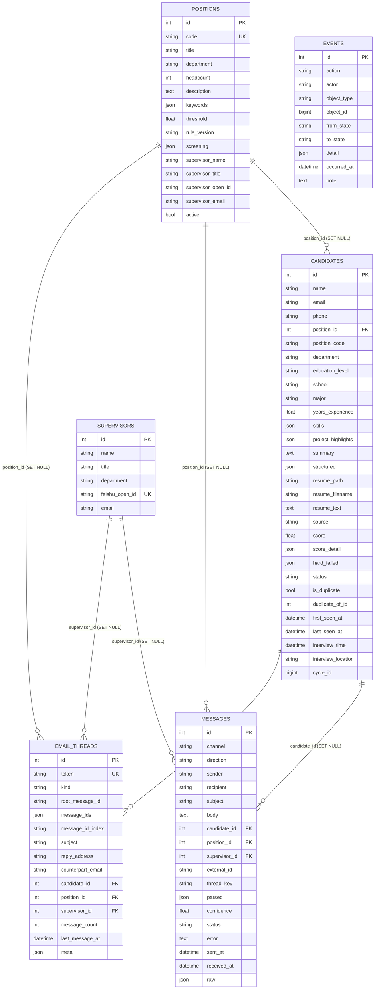

# 04 · 数据模型与存储位置

- 数据库类型：**PostgreSQL 16**（`docker-compose.yml:5` `postgres:16-alpine`）
- 驱动 / ORM：`asyncpg` + SQLAlchemy 2.x Async（`core/db.py:20-32`）
- 连接来源：`DATABASE_URL`（`.env`，默认 `postgresql+asyncpg://hr:hr@localhost:5432/hr_robot`，`config/settings.py:41`）；密码不入本报告
- 运行库实测（本次只读查询 `docker exec pgsql psql`）：
  - 表：`candidates`(32 列) / `email_threads`(17) / `events`(12) / `messages`(21) / `positions`(17) / `supervisors`(8)
  - 行数：candidates 24、positions 5、supervisors 3、messages 56、events 110、email_threads 10
  - **`alembic_version` 表不存在** → 该库是由 `create_all` 建的，Alembic 迁移**未在本机应用**（见 §5）

---

## 1. ER 图

所有表都继承 `TimestampMixin`（`created_at`/`updated_at`，naive UTC，`model/base.py:19-23`）。

---

## 2. 逐表字段（以 ORM 为准，附源码行号）

### 2.1 `positions`（`model/position.py:19-44`）

| 列 | 类型 | 约束/默认 | 说明 |
|---|---|---|---|
| id | Integer | PK | |
| code | String(64) | unique, index, not null | 职位代码（YAML 的 `positions[].code`） |
| title | String(128) | not null | 职位名，归位时按长度倒序匹配 |
| department | String(64) | not null, default "" | 部门名 |
| headcount | Integer | default 1 | 招聘人数（**未参与任何计算**，仅展示/配置） |
| description | Text | default "" | JD 摘要，喂给语义分/深度解析 |
| keywords | JSON | default [] | 归位用关键词 |
| threshold | Float | default 60.0 | 加权及格线 |
| rule_version | String(32) | default "v1" | 规则版本留痕 |
| screening | JSON | default {} | `ScreeningConfig` 完整快照（hard_conditions/weighted/semantic_weight/always_pass_names） |
| supervisor_name / supervisor_title / supervisor_open_id / supervisor_email | String | — | 主管映射的**冗余快照**（避免 join） |
| active | Boolean | default True | YAML 里删掉的职位置 false，不物理删除 |

写入口：`repository/position.py:35-108` `sync_from_config()`，每轮 `run_daily_cycle` 开头调用。

### 2.2 `supervisors`（`model/supervisor.py:12-23`）

| 列 | 类型 | 约束 |
|---|---|---|
| id | Integer | PK |
| name | String(64) | not null |
| title | String(32) | default "" |
| department | String(64) | default "", index |
| feishu_open_id | String(128) | **unique**, index, not null |
| email | String(255) | default "" |

### 2.3 `candidates`（`model/candidate.py:64-115`）

| 分组 | 列 | 类型 | 备注 |
|---|---|---|---|
| 身份 | id | Integer | PK |
| | name / email / phone | String(64/255/32) | 均 index；email 存小写 |
| 归位 | position_id | Integer | FK positions.id ON DELETE SET NULL |
| | position_code / department | String | 冗余存，避免异步懒加载 |
| 结构化 | education_level / school / major | String(16/128/128) | |
| | years_experience | Float | |
| | skills / project_highlights | JSON | list[str] |
| | summary | Text | 模型生成的摘要 |
| | structured | JSON | `ExtractedCandidate.model_dump()` 全量快照 |
| 简历 | resume_path | String(512) | **磁盘路径**（不是内容） |
| | resume_filename | String(255) | |
| | resume_text | Text | **正文文本，入库时截断 50,000 字符**（`service/ingestion.py:264`） |
| | source | String(32) | `imap` / `imap-body` / `manual` / `manual-text` |
| 筛选 | score | Float | 最终分（影子模式下=规则分） |
| | score_detail | JSON | `ScreeningResult.model_dump()`（含 hits/hard_conditions/deep_analysis） |
| | hard_failed | JSON | 未通过的硬条件 label 列表 |
| 状态 | status | String(32) | index，取值见 §3 |
| 去重 | is_duplicate / duplicate_of_id | Boolean / Integer | **两列当前从不被写入**（见 00_PROJECT_BRIEF 差异 D-3） |
| | first_seen_at / last_seen_at | DateTime | 重复投递只刷新 last_seen_at |
| 面试 | interview_time | DateTime | **naive UTC** |
| | interview_location | String(255) | |
| | cycle_id | BigInteger | index，格式 `YYYYMMDDHHMM`（`service/orchestrator.py:54-55`） |

### 2.4 `messages`（`model/message.py:25-57`）

| 列 | 类型 | 说明 |
|---|---|---|
| channel | String(16) | `feishu` / `email`（`model/message.py:15-17`） |
| direction | String(16) | `inbound` / `outbound` |
| sender / recipient | String(255) | 群推送时 recipient 记 `feishu-group`（`service/notification.py:934-936`） |
| subject / body | String(512) / Text | 全文留痕 |
| candidate_id / position_id / supervisor_id | Integer | FK，SET NULL |
| external_id | String(255) | 飞的 message_id 或邮件 Message-ID（**幂等键**） |
| thread_key | String(255) | 飞书 chat_id / 邮件 token |
| parsed | JSON | 抽取结果（面试安排 / 意图） |
| confidence | Float | 抽取置信度 |
| status | String(32) | `sent` / `received` / `failed` / `mocked` / **`pending_approval`** / `superseded` / `cancelled`（后三者由面试通知闸门写入，`service/notification.py:496,578,690`） |
| error | Text | 失败原因 |
| sent_at / received_at | DateTime | naive UTC |
| raw | JSON | references、附件名、事件原因等 |

### 2.5 `email_threads`（`model/email_thread.py:28-61`）

| 列 | 类型 | 说明 |
|---|---|---|
| token | String(64) | unique，`reply+<token>@` 路由键 |
| kind | String(32) | `resume_package` / `interview_notice` / `interview_update` / `decline_ack`（`model/email_thread.py:21-25`；后两者定义了但**未发现写入点**） |
| root_message_id | String(255) | index |
| message_ids | JSON | 本线程全部 Message-ID（审计） |
| message_id_index | String(1024) | 空格拼接，供 LIKE 匹配（SQLite 时代为兼容 JSON 查询而加，PG 下沿用） |
| subject / reply_address / counterpart_email | String | |
| candidate_id / position_id / supervisor_id | Integer | FK，SET NULL |
| message_count / last_message_at | Integer / DateTime | |
| meta | JSON | 例：`{"package_name": ..., "passed_count": ...}` / `{"interview_time": ...}` |

### 2.6 `events`（`model/event.py:23-37`）

| 列 | 类型 | 说明 |
|---|---|---|
| action | String(64) | index，例：`candidate.received`、`screening.rejected`、`interview.notice_sent` |
| actor | String(32) | `robot` / `supervisor` / `candidate` / `hr` / `system`（`model/event.py:15-20`） |
| object_type / object_id | String(32) / BigInteger | 多态指向（candidate / message / cycle / supervisor） |
| from_state / to_state | String(32) | 状态机证据 |
| detail | JSON | 明细 |
| occurred_at | DateTime | index |
| note | Text | 人读的一句话 |

---

## 3. 候选人状态枚举（实际 11 个）

`model/candidate.py:20-61`（直接证实）。文档多处称"10 个冻结"（`AGENT.md:188`、`docs/DESIGN` 等），**实际多出 `interview_pending_confirm`**（面试通知已生成待 HR 确认），它在 `service/notification.py:482` 与 `service/feedback.py:686` 被真实使用。

| 值 | 中文标签 | 进入条件 | 证据 |
|---|---|---|---|
| received | 已收取 | 新建或未归位 | `service/ingestion.py:266,399` |
| parsed | 已解析 | 抽取完成后立即推进 | `service/ingestion.py:289` |
| screened_passed | 筛选通过 | `evaluate().passed` | `service/screening.py:480-482` |
| screened_rejected | 筛选淘汰（终态） | 硬条件不过或低于阈值 | 同上 |
| dispatched | 已发主管 | 分发后（**不看发送成功与否**） | `service/notification.py:177` |
| supervisor_feedback | 主管已反馈 | 主管给出名单+时间 | `service/feedback.py:412` |
| interview_pending_confirm | 面试通知待确认 | 闸门挂起 | `service/notification.py:482` |
| interview_notified | 已邮件通知 | 通知发送后 / 改期确认后 | `service/notification.py:423,880` |
| reschedule_pending | 改期中 | 候选人回信 intent=reschedule | `service/inbound_email.py:224` |
| declined | 已放弃（终态） | intent=decline | `service/inbound_email.py:226` |
| completed | 已完成（终态） | intent=confirm | `service/inbound_email.py:228` |

---

## 4. 数据落在哪里（DB / 磁盘 / 内存）

| 数据 | 位置 | 证据 |
|---|---|---|
| 简历原件（pdf/docx/txt） | **磁盘** `var/resumes/<timestamp>-<hash>-<原名>` | `client/resume_parser.py:513`（写盘）+ `settings.resumes_dir`（`config/settings.py:121-123`） |
| 简历纯文本 | **数据库** `candidates.resume_text`（截断 5 万字符） | `service/ingestion.py:264` |
| 简历磁盘路径 | **数据库** `candidates.resume_path`（只有路径） | `service/ingestion.py:262` |
| 结构化字段 + 全量抽取快照 | **数据库** JSON 列 | `service/ingestion.py:254-261` |
| 筛选明细（命中项、硬条件、深度解析） | **数据库** `candidates.score_detail` JSON | `service/screening.py:477-478` |
| 简历包 zip | **磁盘** `var/packages/<cycle_id>/<部门>-<职位>-简历N份-<yyyymmddHHMM>.zip` | `service/notification.py:217-221` |
| mock 模式发出的邮件 | **磁盘** `var/outbox/mail/*.eml` | `client/mailbox.py:181-191` |
| mock 模式收到的邮件 | **磁盘** `var/mock_inbox/*.eml` + `.state.json`（处理水位） | `client/mailbox.py:222-244` |
| IMAP UID 水位 | **磁盘** `var/imap_state.json`（`{"last_uid": N}`） | `client/mailbox.py:266-273,303-304` |
| 邮件正文/主题/收件人 | **数据库** `messages` | `service/notification.py:1045-1076`、`service/inbound_email.py:200-218` |
| 飞书消息文本 | **数据库** `messages`（`status=mocked` 时即"应发内容"） | `service/notification.py:1014-1043` |
| 事件流水 | **数据库** `events` | `repository/event.py:19-43` |
| 公司/职位/主管配置 | **YAML 文件**（`config/positions.yaml`）→ 每轮同步进 `positions`/`supervisors` | `repository/position.py:35-108` |
| 出站文案模板 | **文件** `config/templates/*.md`（Jinja2） | `service/notification.py:73-84` |
| 岗位专业词库 | **文件** `config/majors.txt`（178 行） | `client/resume_parser.py:251` |

**注意（常见误读）**：
- 简历**原件**不在数据库里，只有路径 + 文本副本；`resume_text` 是**文本内容**（截断），`resume_path` 是**路径**，两者不可混为一谈。
- 简历包 zip 只在磁盘，`messages.parsed.path` 里记了路径（`service/notification.py:170`）。

---

## 5. 迁移 vs 模型的一致性

| 检查项 | 结果 | 证据 |
|---|---|---|
| 迁移文件数量 | 仅 1 个：`migrations/versions/0001_initial.py`（6 张表 + 外键 + 索引） | 目录清单 |
| 迁移的列 vs ORM 的列 | **逐表一致**（candidates 32 列、messages 21、email_threads 17、positions 17、supervisors 8、events 12，与实测库一致） | `migrations/versions/0001_initial.py:25-194` 对照 `model/*.py` |
| 迁移是否在本机库上执行过 | **没有**：`hr_robot` 无 `alembic_version` 表 | psql 只读查询（本次） |
| 运行时建表方式 | `Base.metadata.create_all`（`factory/lifespan.py:90` → `core/db.py:35-44`） | 直接证实 |
| 风险 | `create_all` **只建缺失的表，不改已有表的列**。以后给 `Candidate` 加字段，部署后新库有列、老库没列；若同时跑 Alembic 又会产生两套真相 | `core/db.py:35-44` 注释也承认"运行时用 Alembic，测试与脚本用本函数" |
| 迁移的 `server_default` 写法 | JSON 列用 `server_default="[]"`/`"{}"` 字符串（`migrations/versions/0001_initial.py:33,36,77,80,87,123,129,151,161,185`），在 PG 上依赖隐式 cast；本机未实际执行过该迁移，**未验证** | 同上 |

---

## 6. 数据库层面的隐性约束（源码层实现，不是 DB 约束）

| 约束 | 实现位置 | 强度 |
|---|---|---|
| 同一 Message-ID 只发一次邮件 | `messages` 查询 `find_delivered`（`repository/message.py:35-51`） | 应用层，**无唯一索引**，并发下有窗口 |
| 飞书内容级去重（收件人+正文） | `repository/message.py:53-71` | 应用层 |
| 候选人去重（邮箱 OR 手机号） | `repository/candidate.py:17-32` | 应用层，**email/phone 无唯一索引**（`migrations/versions/0001_initial.py:100-102` 只有普通索引） |
| 职位 code 唯一 | `model/position.py:23` unique + 迁移 `ix_positions_code` unique | DB 层 |
| 主管 open_id 唯一 | `model/supervisor.py:19` unique + 迁移 unique 索引 | DB 层 |
| 线程 token 唯一 | `model/email_thread.py:32` unique + 迁移 unique 索引 | DB 层 |
| 时间统一 naive UTC | `model/base.py:15-16` + `core/timeparse.py:96-115` | 约定，非约束 |
