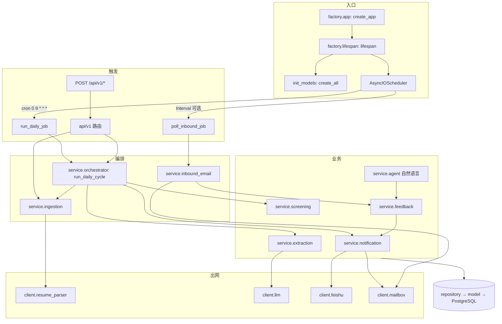
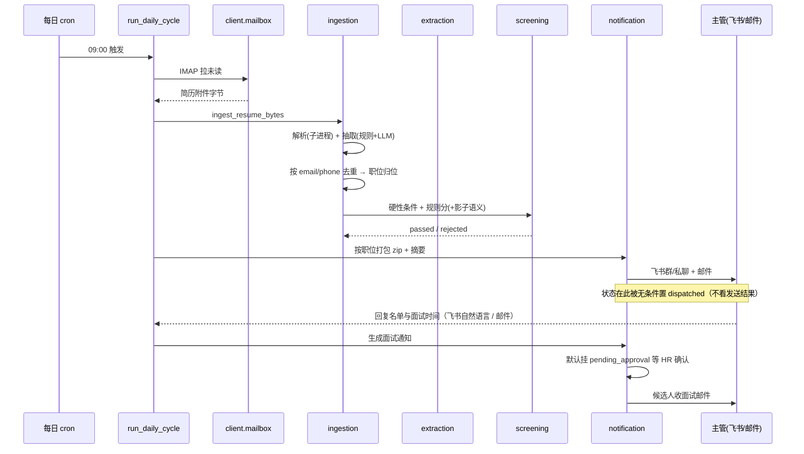

# PROJECT INTEL BUNDLE · ai-hr 飞书招聘机器人（一文件速览）

- 生成时间：2026-11-14T01:20+08:00
- 仓库：`D:\!pythonproject\hr_ai_robot`
- 分支 / commit：`develop` / `bf2cc81fb7b18aafc45c2e47ae844def216e4b8e`（2026-11-13 20:58:20 +0800，commit message：`飞书自然语言，以及云数据库测试`）
- 工作区：`git status --short` 仅 `?? project-intel/`（本产物目录），**源码零改动**
- 本文件定位：给 ChatGPT 网页端的**单文件入口**。细节在各分册，本文件只做压缩与索引，不替代证据。

| 分册 | 内容 | 什么时候看 |
|---|---|---|
| `00_PROJECT_BRIEF.md` | 项目事实底稿、文档差异 D-1~D-7 | 想知道"这项目到底是什么" |
| `01_REPO_TREE.md` | 目录树 + 真实职责 + 入口顺序 | 找文件 |
| `02_ARCHITECTURE.md` | 分层、装配、调度、外部边界 | 想知道依赖怎么流 |
| `03_BUSINESS_FLOWS.md` | 13 条业务链 Mermaid | 想知道"跑起来发生什么" |
| `04_DATA_MODEL.md` | ER 图 + 6 表逐列 + 11 状态 | 改数据/写查询 |
| `05_CONFIG_AND_DEPLOYMENT.md` | 环境变量、容器、部署风险 R-1~R-7 | 要部署 |
| `06_API_AND_INTEGRATIONS.md` | 14 个端点 + 飞书/邮件/LLM 集成 | 要对接 |
| `07_TESTS_AND_GAPS.md` | 190 passed 实测 + 缺口 G-1~G-9 + 风险 K-1~K-12 | 要验收 |
| `08_SYMBOL_INDEX.json` | 90 个符号的机器可读索引 | 要精确定位符号 |
| `09_OPEN_QUESTIONS.md` | 34 条待确认（Q-1~Q-34） | 要决策 |
| `SOURCE_EVIDENCE.md` | 20 组逐字源码证据 E-01~E-20 | 要核对结论 |

---

## 1. 一句话定位

**一个"无人值守的招聘闭环机器人"**：定时从 HR 邮箱收简历 → 解析抽取 → 去重归位 → 规则（+影子语义）筛选 → 打包成 zip 发主管（飞书 + 邮件）→ 接收主管名单与面试时间（飞书自然语言或邮件）→ 生成面试通知（HR 确认后发）→ 持续处理候选人改期/放弃回信。

**没有 Web 管理界面**（已核实：`api/` 下只有 json 接口，无模板/静态资源路由）。

## 2. 技术栈（源码确认版）

| 层 | 选型 | 证据 |
|---|---|---|
| Web | FastAPI + uvicorn，**应用工厂** `create_app` | `factory/app.py:31` |
| ORM | SQLAlchemy 2.x async，`asyncpg`（PG）/`aiosqlite`（测试） | `core/db.py`、`requirements.txt` |
| DB | PostgreSQL 16（compose `postgres:16-alpine`） | `docker-compose.yml` |
| 迁移 | Alembic **已引入**，但启动仍走 `create_all` | `alembic.ini`、`factory/lifespan.py:90` |
| 调度 | APScheduler `AsyncIOScheduler` + `CronTrigger.from_crontab` | `factory/lifespan.py:48-75` |
| 配置 | pydantic-settings，`extra="ignore"` | `config/settings.py` |
| LLM | litellm 多供应商降级链 + httpx 直连兜底 | `client/llm.py`、`config/settings.py:151` |
| 邮件 | IMAP 收 + SMTP 发（标准库 `imaplib`/`smtplib` 封装） | `client/mailbox.py` |
| 飞书 | `lark_oapi` SDK 封装（发消息/文件/解密） | `client/feishu.py:1` |
| 解析 | 子进程隔离（`multiprocessing` spawn）防 PDF 段错误 | `core/safe_process.py`、`client/resume_parser.py` |

## 3. 仓库地图（压缩版）

```
api/v1/      6 文件  346 行   14 个端点，无鉴权
client/      5 文件 2271 行   唯一出网层：llm / mailbox / feishu / resume_parser
config/      2 文件  261 行   Settings + 公司配置模型
core/        9 文件 1117 行   db / deps(Container) / safe_process / timeparse / logging
factory/     5 文件  216 行   create_app / lifespan / routers / middleware
middlewares/ 4 文件  141 行   access_log / request_id / exception
model/       8 文件  388 行   6 张表 + 11 个状态常量
repository/  7 文件  594 行   数据访问，按聚合拆分
schema/      8 文件  854 行   pydantic 出入参（注意是 schema 不是 schemas）
service/    10 文件 4622 行   业务编排（最大：notification / feedback / ingestion / agent）
prompt/      3 文件  470 行   LLM 提示词（agent.py / extraction.py / screening.md）
tests/      19 文件 2868 行   190 个用例
scripts/    17 文件 2374 行   运维脚本（init_db / run_cycle_once / e2e_four_chains / ab_semantic …）
migrations/  2 文件  296 行   env.py + 0001_initial
```

合计 `git ls-files '*.py'` = **105 文件 / 16,818 行**；业务代码（不含 tests/scripts/migrations）= **67 文件 / 11,280 行**。

## 4. 架构与装配



- **两级容器**：进程级 `Container`（settings/engine/scheduler，`core/deps.py:41`）+ 请求级 `build_services(session)`（`:121` 为每个请求绑一个 `AsyncSession`）。
- **出网收敛**：只有 `client/` 直接访问外部；`service/` 不读环境变量、不直连 SDK（这是可 mock 的基础）。
- **并发约束**：两个 job 均 `coalesce=True, max_instances=1`，但该参数**只约束单进程内**——多副本会重复执行。

## 5. 主闭环（一张图看完）



## 6. 数据模型（6 表）

| 表 | 作用 | 关键点 |
|---|---|---|
| `positions` | 在招职位与主管映射 | 决定简历归到哪个主管 |
| `supervisors` | 主管通讯录 | 飞书 open_id / 邮箱 |
| `candidates` | 候选人主表 | `email`/`phone` **无唯一索引**；`is_duplicate`/`duplicate_of_id` 从不写入 |
| `events` | 候选人事件流水 | 状态迁移全留痕（`from_state`/`to_state`） |
| `messages` | 收发留痕（飞书+邮件） | 兼作幂等表（`external_id` / 内容匹配） |
| `email_threads` | 邮件线程聚合 | `message_id_index` 用 `LIKE %id%` 匹配 |

**11 个状态**（文档写 10 个，漏了第 8 个）：
`received → parsed → screened_passed / screened_rejected → dispatched → supervisor_feedback → interview_pending_confirm → interview_notified → reschedule_pending → declined → completed`

## 7. 三态开关（决定"跑的是真货还是假货"）

| 开关 | 取值 | 含义 |
|---|---|---|
| `FEISHU_MODE` | `mock` / `live` | mock 只落 `var/` 不真发 |
| `MAIL_MODE` | `off` / `mock` / `live` | **有 `off`**，可完全关闭收发 |
| `LLM_MODE` | `auto` / `live` / `off` | `auto` 无 key 时自动降级 |
| `SEMANTIC_SHADOW` | `true`（默认） | 语义分只记录、不参与判定 |
| `INTERVIEW_NOTICE_REQUIRE_CONFIRM` | `true`（默认） | 面试通知挂起等 HR 确认 |
| `SCHEDULER_ENABLED` | 布尔 | 关掉后只能手动打接口/跑脚本 |

> **当前工作区 `.env` 的实际状态（只读键值，均为非敏感开关）**：`FEISHU_MODE=live`、`MAIL_MODE=live`、`LLM_MODE=live`、`SEMANTIC_SHADOW=true`、`SCHEDULER_ENABLED=true`、`INBOUND_POLL_SECONDS=0`、`INTERVIEW_NOTICE_REQUIRE_CONFIRM=true`。
> 含义：**在本机触发一轮闭环会真实发飞书、真实发邮件**（受"面试通知需 HR 确认"闸门保护，但简历包分发不受保护）。做实验前请先把 `FEISHU_MODE`/`MAIL_MODE` 改回 `mock`。

## 8. API（14 个，全部 `/api/v1` 前缀，全部无鉴权）

| 方法 | 路径 | 用途 |
|---|---|---|
| POST | `/recruitment/run` | 手动触发一轮完整闭环 |
| POST | `/recruitment/ingest` | 上传简历文件 |
| POST | `/recruitment/ingest/text` | 导入简历纯文本 |
| GET | `/recruitment/candidates` | 候选人列表 |
| GET | `/recruitment/candidates/{id}` | 候选人详情 |
| GET | `/recruitment/candidates/{id}/events` | 单人事件流水 |
| GET | `/recruitment/events` | 全局最近事件 |
| GET | `/recruitment/messages` | 收发留痕 |
| GET | `/recruitment/positions` | 在招职位与主管 |
| POST | `/feishu/webhook` | 飞书事件回调 |
| POST | `/email/poll` | 手动收信一次 |
| POST | `/email/test` | 通道自检发信 |
| POST | `/email/simulate-inbound` | 模拟入站邮件 |
| GET | `/health` | 健康检查（容器 HEALTHCHECK 用） |

## 9. 测试现状

- 实测命令：`pytest`（`TEST_PG_AUTOSTART=0`，复用已有 `hr_robot_test` 库）
- 结果：**190 passed，1 分 16 秒，0 失败**
- ⚠️ **当前无法复跑**：`.venv` 解释器变成 3.14.7，而已装二进制是 `cp313` → `import asyncpg`/`pydantic_core` 直接失败。这是**环境问题不是代码问题**，修法见 `09` Q-22（需你授权后再动）。
- 覆盖薄弱：`service/agent.py`（460 行）**零直接测试**；真实 SMTP/IMAP/飞书**全为 mock**；迁移从未实跑。

## 10. 风险与差异速查（详见 07 / 09）

**硬差异（文档 vs 源码）**

| ID | 一句话 |
|---|---|
| D-1 | `Dockerfile:27` 启动 `main.py`，但仓库根目录没有这个文件 → 容器起不来 |
| D-2 | 状态枚举实际 **11** 个，四处文档写 10 个 |
| D-3 | `is_duplicate`/`duplicate_of_id` 只有列定义，代码从不赋值 |
| D-4 | 文档称"未引入 Alembic"，实际已引入且与 `create_all` 并存 |
| D-5 | `README.md:7` 指向根目录 `API.md`/`DECISIONS.md`，实际在 `docs/` |
| D-6 | 用例数 154（测试报告）vs 190（README + 实测） |
| D-7 | 测试报告写项目在 `E:\`，本机在 `D:\` |

**最该先处理的 5 个技术风险**

| ID | 一句话 | 位置 |
|---|---|---|
| K-1 | 分发/通知状态**不看发送结果**就推进 → "以为发了其实没发" | `service/notification.py:175-177`、`:422-424` |
| Q-13 | **全部 HTTP 接口无鉴权**（检索空命中） | `api/`、`factory/middleware.py:16-18` |
| R-1 | 飞书回调**不验签**，且 token 为空时校验被短路 | `client/feishu.py:412-415` |
| K-2 | 去重只靠 `email`/`phone` 且**无唯一索引** → 并发可产生重复候选人 | `repository/candidate.py:17-32` |
| K-6 | `create_all` 与 Alembic 并存 → 加字段后老库启动即 `UndefinedColumn` | `factory/lifespan.py:90` |

## 11. Top 5 待确认（完整 34 条见 `09_OPEN_QUESTIONS.md`）

1. **Q-22** 本机 `.venv` 已损坏（3.14 解释器 + cp313 二进制），怎么修？
2. **Q-1/Q-23** Docker 的 `CMD` 改 `uvicorn ... --factory`，还是补根 `main.py`？（改动需授权）
3. **Q-13/Q-15** 要不要给接口加鉴权、给回调加验签？
4. **Q-8** 发送失败时状态该不该回滚/重试？
5. **Q-4/Q-20** 建表以 Alembic 为准，还是以 `create_all` 为准？

## 12. 扫描边界（避免误读为"全仓库已逐行验证"）

- **逐行读过**：`api/ client/ config/ core/ factory/ middlewares/ model/ repository/ schema/ service/` 全部 `.py`；`migrations/versions/0001_initial.py`、`migrations/env.py`；`README.md`、`AGENT.md`、`docs/design/`、`docs/quality/`；`Dockerfile`、`docker-compose.yml`、`pytest.ini`、`alembic.ini`、`.env.example`。
- **仅目录级/索引级**：`prompt/`（3 个文件未逐字读）、`scripts/`（17 个脚本按名称与用途定位）、`docs/guide/`、`docs/ops/`、`docs/archive/`。
- **明确排除**：`.venv/`、`.git/`、`.pytest_cache/`、`.idea/`、`var/`（运行时产物）、`tests/testdata/`、`.env` 的**取值**。
- **未执行**：任何外发网络请求、任何代码修改、任何数据库迁移、任何依赖安装。
- **行号基准**：全部基于 commit `bf2cc81` 的工作区版本；若源码已变更，行号需重新核对（`08_SYMBOL_INDEX.json` 里每个符号都带 `line_start`/`line_end`，便于批量复核）。
